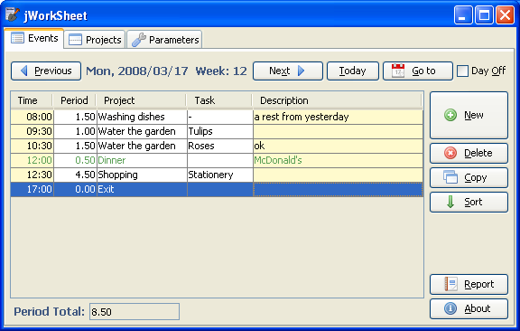

# jWorkSheet


**jWorkSheet** is an open source personal desktop time tracker for your projects,
data are presented in a spreadsheet like format.
Application offers some completed work sheet reports, however you can create your own user reports by XSL transformations.

### Screenshots



See the [link](https://pponec.github.io/jworksheet/screenshots/) for more screenshots.

### Build

```shell
./mvnw package                # fat jar
./mvnw -Pinstallers package   # fat jar + installer in target/dist
```

Installers carry their own runtime: `.dmg` (macOS), `.msi` (WiX 3, Windows),
`.deb` (`fakeroot`, Linux). CI runs the same target after the Maven build and
refreshes `latest`.

### Links

* GitHub Home Page: https://pponec.github.io/jworksheet/
* Video tutorial: [JWorkSheet-en.htm](https://pponec.github.io/jworksheet/flash/JWorkSheet-en.htm)
* Release notes: https://pponec.github.io/jworksheet/javadoc/changes.txt
* Ujorm framework: https://ujorm.org/
* Original Home Page: https://jworksheet.ponec.net/
